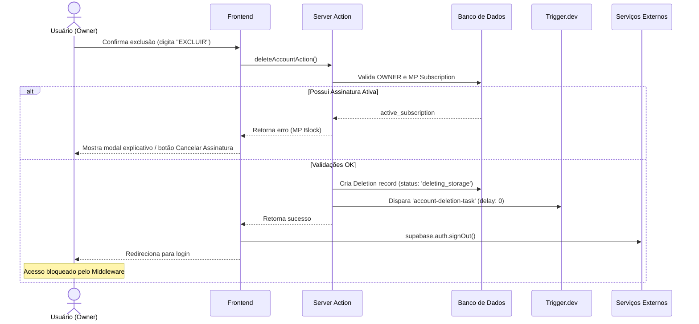

# Arquitetura de Exclusão Imediata e Assíncrona de Conta

Este documento descreve a nova arquitetura da Dudit para encerramento definitivo de parceiros e usuários. O fluxo foi refatorado para remover o período de carência de 48 horas, executando a limpeza de forma assíncrona por meio do Trigger.dev de maneira robusta, tolerante a falhas e idempotente.

---

## 1. Visão Geral do Fluxo

---

## 2. Estratégia de Checkpoints e Idempotência (Trigger.dev)

A task assíncrona foi projetada como uma Saga com checkpoints lineares de estado. Se qualquer etapa falhar, a execução é interrompida e retentada pelo Trigger.dev. Ao reiniciar, a task lê a coluna `checkpoints.step_status` e pula etapas já executadas com sucesso.

### Etapas e Ações

1. **`deleting_storage`**:
   * **Ação**: Purga recursiva de arquivos no bucket Cloudflare R2 sob o prefixo `users/{userId}/`.
   * **Idempotência**: Pula se `step_status.deleting_storage.completed` for `true`.

2. **`deleting_external_services`**:
   * **Ação**: Disconecta instâncias ativas do WhatsApp na Evolution API e cancela assinaturas pendentes dos clientes da loja no Mercado Pago.
   * **Idempotência**: Desconecta somente instâncias existentes; ignora erros de "not found" no Mercado Pago.

3. **`deleting_marketplace`**:
   * **Ação**: Invalida caches Redis do parceiro e remove índices de busca na vitrine do Marketplace.
   * **Idempotência**: Operações do Redis são estruturalmente idempotentes (`DEL` / `ZREM`).

4. **`deleting_database`**:
   * **Ação**: Executa a Procedure SQL `execute_account_deletion_db` por RPC e higieniza/anonimiza registros históricos de faturamento (pedidos e itens) para conformidade com o Art. 27 do Código de Defesa do Consumidor (retenção de 5 anos para forensics).
   * **Idempotência**: Chaves primárias excluídas por cascade não produzem efeitos colaterais em execuções repetidas.

5. **`deleting_auth`**:
   * **Ação**: Exclui a conta do usuário na tabela interna do Supabase Auth (`auth.users`), o que invalida permanentemente os tokens JWT emitidos.

6. **`completed`**:
   * **Ação**: Emite o certificado SHA-256 final contendo a volumetria purgada e insere o log de auditoria compliance em `compliance_logs`.

---

## 3. Segurança e Controle de Acesso

* **Bloqueio no Middleware**: Assim que a Server Action cria o registro de exclusão, a sessão do usuário é imediatamente encerrada e qualquer tentativa subsequente de autenticação é bloqueada pelo Middleware, pois existe um registro ativo em `account_deletions`.
* **Privilégios**: Apenas o usuário registrado como `OWNER` principal (`partners.user_id === user.id`) pode deletar o parceiro e suas respectivas lojas. Perfis de administradores comuns (`ADMIN`) ou inferiores são sumariamente rejeitados.
* **Isenção de Bloqueio**: Chamadas executadas com chaves `service_role` (como a própria execução do Trigger.dev e cron jobs internos) ignoram as restrições do Middleware e RLS para finalizar o processamento com sucesso.
